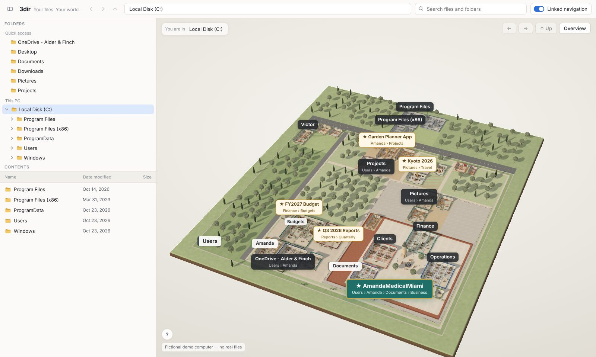
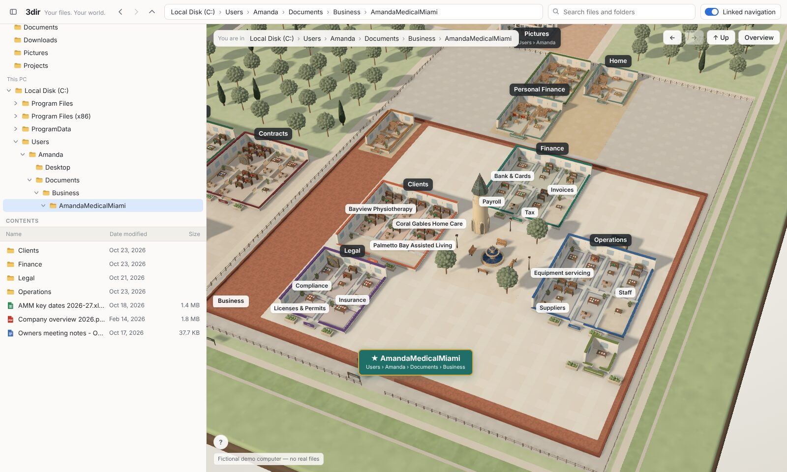
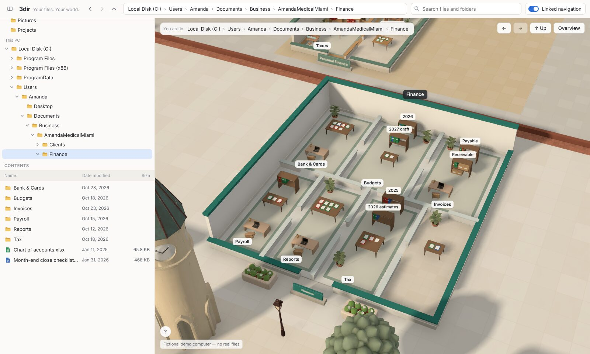
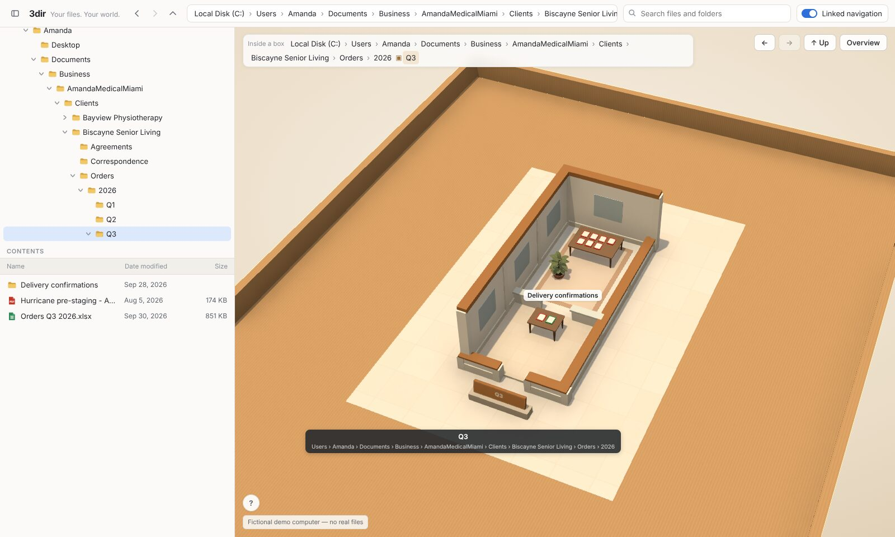

# 3dir
Your files. Your world. — A spatial file explorer and organization system.

**Live demo: <https://vdcoder.github.io/3dir/>** (all data is fictional).

3dir shows an ordinary Windows computer as a miniature town next to a familiar explorer. Important folders
become **areas** you can see from the top of the drive; the folders around them become the **geography** that
holds them (a district, a block, a fenced yard, a brick square), so you always see where something really
lives. Inside an area, folders are buildings, rooms, shelves and boxes, and every file is an object you can
select, preview and find in both views. Any closed box opens into a world of its own, at any depth.



| AmandaMedicalMiami campus | Its Finance building | Inside a box, ten folders deep |
| --- | --- | --- |
|  |  |  |

The product spec is [`docs/PROTOTYPE_CHARTER.md`](docs/PROTOTYPE_CHARTER.md); status, known limitations and
budget are in [`docs/PROGRESS.md`](docs/PROGRESS.md); asset sources, licenses and credits in
[`docs/ASSETS.md`](docs/ASSETS.md).

## A three-minute tour

1. Open the demo: the whole C: drive. At the front is the teal **★ AmandaMedicalMiami** campus. Its label shows
   where it really is (Users › Amanda › Documents › Business), and you can see that on the ground too: the
   brick Business square, inside the fenced Documents yard, inside Amanda's block, inside the Users district.
2. Double-click the campus. Four buildings around a plaza: Finance, Clients, Legal, Operations.
   Click a room or a binder: it's selected in both views, and nothing moves.
3. Press **Up** (top bar) a few times: Business, Documents, Amanda. Up always means "the folder that contains
   this one". Press **Back** to go back through the places you actually visited. Hold **Alt** to see every name.
4. Search for "Hurricane pre-staging" and pick the result. The file is ten folders down, inside a closed box
   (`…\Clients\Biscayne Senior Living\Orders\2026\Q3`); its tag says so. Double-click the box to go inside:
   a world of its own, on a cardboard floor, marked "Inside the “Q3” box". **Leave box** (or Up) takes you back
   out to its shelf.
5. Notice the ★ pins on the overview: *FY2027 Budget* lives five folders deep in Amanda's OneDrive, but you can
   see it, and go to it, from the top.
6. Press **Overview** to return to the whole map.

## Run it

Requires Node 22+.

```
npm install
npm run dev                 # local dev server
npm test                    # unit tests
npm run build
npm run test:e2e            # headless browser smoke test
npm run test:interactions   # explorer/world synchronization checks
```

Live demo: <https://vdcoder.github.io/3dir/> (every push to `main` deploys automatically).

## Using it

- **Explorer (left):** familiar folder tree, file list, address bar, back/forward/up, search.
- **World (right):** drag to pan, right-drag to rotate, scroll to zoom. Click to select; double-click to go into a
  folder (a building, a room, a shelf or a closed box) or open a file; click a ★ pin to go to it.
- **Back / Forward / Up** (top bar) step through places you visited, or go to the containing folder, even out
  of a box. **Overview** returns to C:. Selecting something never moves you.
- Hover anything to see what it is and what double-click will do. Hold **Alt** (or press **Reveal**) to see
  every name and boundary at once.
- **Details** of the selection sit at the bottom of the explorer pane, with Open and Show location.
- **Linked navigation** (top bar) keeps both views in the same place, with one set of controls. Turn it off to
  explore them independently: the world then gets its own path and Back / Forward / Up, and the details offer
  **Show in World** and **Show in Explorer**.

## Generating 3D assets (Meshy)

Only in an environment where `api.meshy.ai` is allowed and the proxy injects the API key.

```
npm run meshy -- balance
npm run meshy -- budget
npm run meshy -- concept --name <slug> --prompt "<text>"
npm run meshy -- model --name <slug> --concept <slug> --tier prop --max-credits 15
```

Every paid call is logged in `assets-src/meshy/assets.jsonl`. See `docs/ASSETS.md`.

## Layout

- `src/data` — the fictional computer (authoring format, compiler, seed content)
- `src/model` — canonical filesystem types and index (no 3D)
- `src/mapping` — the Spatial Compiler, from folders to places (no rendering):
  - `plan.ts` curated importance, themes and pins; `importance.ts` rules for everything else
  - `areaPlanner.ts` Stage 1a: which folders become areas, and the regions (their real ancestors) around them
  - `geography.ts` Stage 1b: nested, non-overlapping rectangles for regions, areas and roads
  - `areaRenderer.ts` Stage 2: any folder as buildings, rooms, shelves, sections, files and boxes
  - `world.ts` the main map and on-demand box-worlds; which world shows any folder
  - `decor.ts` decorative props, never pickable
- `src/state` — navigation rules (location, history, selection per view) and the store
- `src/ui` — the 2D explorer
- `src/scene` — the 3D world (React Three Fiber); `pickPolicy.ts` + `picking.tsx` decide what a click means
- `tools/` — asset tooling; `tests/e2e/` — browser tests and screenshot scenarios
- `experiments/` — throwaway proofs, not part of the app
