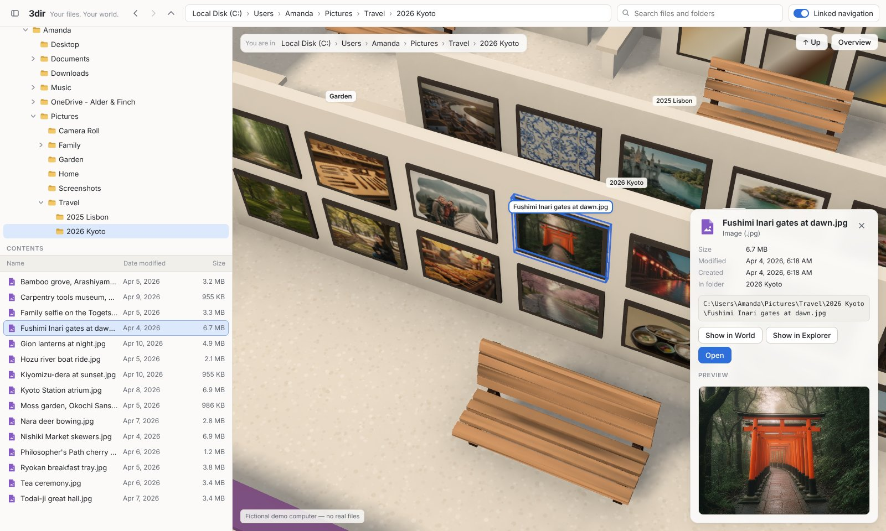
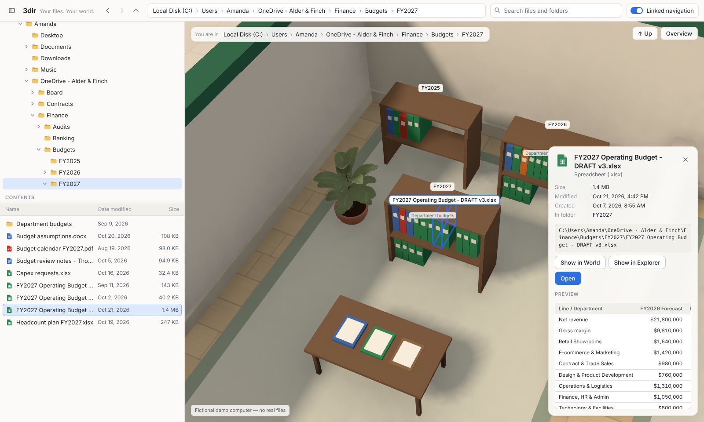

# 3dir
Your files. Your world. — A spatial file explorer and organization system.

**Live demo: <https://vdcoder.github.io/3dir/>** (all data is fictional).

3dir shows an ordinary Windows computer as a miniature town next to a familiar explorer. Districts are the
main areas of the disk, open-roof buildings are important folders, rooms and shelves are the folders inside,
and every file is a colored object you can select, preview and find in both views. Important destinations
deep in the folder tree are pinned on the map, so you can see them, and go to them, from the very top.


| Alder & Finch business district | Kyoto photo wall | Finding the FY2027 budget |
| --- | --- | --- |
|  |  |  |

The product spec is [`docs/PROTOTYPE_CHARTER.md`](docs/PROTOTYPE_CHARTER.md); status, known limitations and
budget are in [`docs/PROGRESS.md`](docs/PROGRESS.md); asset sources, licenses and credits in
[`docs/ASSETS.md`](docs/ASSETS.md).

## A three-minute tour

1. Open the demo: the whole C: drive as a town. The business archive, studio and photo gallery are up
   front; Users and Windows & Programs sit quietly at the back.
2. Notice the ★ pins: *FY2027 Budget* lives five folders deep, but it's visible from here. Click it.
3. You're inside the green Finance hall, at the FY2027 shelf. Click a binder: its name, path, size and a
   preview of the spreadsheet appear, and the explorer on the left shows the same file selected.
4. In the explorer, click another file. The world outlines it without moving the camera; if it's out of
   view, a blue pointer at the edge says where. Press **Show in World** to fly there.
5. Search for "Kyoto" and pick a photo: the gallery's Kyoto wall, with real pictures, and a full-size preview.
6. Press **Overview** to return to the whole map.

## Run it

Requires Node 22+.

```
npm install
npm run dev                 # local dev server
npm test                    # unit tests
npm run build
npm run test:e2e            # headless browser smoke test
npm run test:interactions   # explorer/world synchronization checks
```

Live demo: <https://vdcoder.github.io/3dir/> (every push to `main` deploys automatically).

## Using it

- **Explorer (left):** familiar folder tree, file list, address bar, back/forward/up, search.
- **World (right):** drag to pan, right-drag to rotate, scroll to zoom. Click to select, double-click to enter
  a place or open a file, click a ★ pin to go to it. "↑ Up" and "Overview" are in the top-right corner;
  the "?" button in the bottom-left reopens the short guide and color legend.
- **Linked navigation** (top bar) keeps both views in step. Turn it off to explore them independently;
  **Show in World** and **Show in Explorer** always work.

## Generating 3D assets (Meshy)

Only in an environment where `api.meshy.ai` is allowed and the proxy injects the API key.

```
npm run meshy -- balance
npm run meshy -- budget
npm run meshy -- concept --name <slug> --prompt "<text>"
npm run meshy -- model --name <slug> --concept <slug> --tier prop --max-credits 15
```

Every paid call is logged in `assets-src/meshy/assets.jsonl`. See `docs/ASSETS.md`.

## Layout

- `src/data` — the fictional computer (authoring format, compiler, seed content)
- `src/model` — canonical filesystem types and index (no 3D)
- `src/mapping` — how nodes are placed in the world (curated plan, importance, layout engine)
- `src/state` — selection / current folder / world focus rules and the store
- `src/ui` — the 2D explorer
- `src/scene` — the 3D world (React Three Fiber)
- `tools/` — asset tooling; `tests/e2e/` — browser tests and screenshot scenarios
- `experiments/` — throwaway proofs, not part of the app
