# 3dir progress

Authoritative product spec: [`docs/PROTOTYPE_CHARTER.md`](PROTOTYPE_CHARTER.md). This file only tracks status.

Live demo: <https://vdcoder.github.io/3dir/> (deployed automatically from `main`).

## Current status (2026-10-24, iteration 2: milestones A, B, C and D)

### What the review findings turned out to be
Reproduced before changing anything (see `src/state/navigation.test.ts`, first five cases):
- **Selecting in the world navigated.** A world click moved the explorer to the clicked thing's folder and pushed
  a history entry, so **Up** worked from the wrong folder and **Back** replayed clicks rather than places.
- **Up from a promoted district jumped across the map** (OneDrive → Amanda's house), because promoted districts
  were cut out of their real ancestors and placed at the top level.
- **Deep folders dead-ended.** Below a building's shelves, folders became closed boxes you could not open
  (for example `C:\Program Files\Google\Chrome\Application\155.0.7610.88`).
- **Picking was per-mesh.** Each mesh handled its own clicks, so shelves, room floors and HTML labels could
  each claim the click, and decorations could block it.

### Completed
- **Milestone A, navigation correctness**
  - Each view has its own **location, history and selection** (shared while linked). Selecting never navigates.
  - **Back / Forward** walk visited places only. **Up** is always the canonical parent. **Overview** returns to C:
    and is itself a history step. Linking adopts the world's place without moving the camera.
  - **Every folder is navigable at any depth.** Double-clicking a closed box opens a **box-world**: the same
    renderer rooted at that folder, on a cardboard floor with warmer or cooler light by depth, built on demand.
    The breadcrumb says "Inside a box" and marks the box edge with ▣. No depth limit.
  - **One picking policy** for the whole world: a single raycast, decorations and highlights never intercept,
    the nearest hit wins unless a more specific canonical descendant is hit within reach (a binder in front of
    its shelf, a shelf section rather than the room). Labels and geometry resolve to the same folder.
    Double-click on a folder opens that folder, not its shelf.
- **Milestone B, Spatial Compiler α.v1** (`src/mapping`)
  - **Stage 1a, area planner** (`areaPlanner.ts`): curated importance promotes folders into **areas**
    (campus ≥ 0.95, major ≥ 0.75). Their ancestors become **absorber regions** by depth: district (curbs and
    highway), block (sidewalk ring and street), yard (fence with gate), square (brick wall), garden (hedge),
    court (wall). Everything else stays in **residual areas** of its real parent. No folder is invented,
    duplicated or moved out of its ancestors.
  - **Stage 1b, geography** (`geography.ts`): nested, non-overlapping, deterministic rectangles. The branch that
    holds the most important area takes the front; quiet areas recede to the back of their row.
  - **Stage 2, area renderer** (`areaRenderer.ts`): any folder as a compound of buildings → rooms → shelves,
    tables and photo walls → sections → files and boxes. Campuses get a courtyard and plaza. No second promotion.
  - **Worlds** (`world.ts`): the main map plus box-worlds; `WorldCatalog` knows which world shows any folder
    open, and the chain of boxes to get there.
- **AmandaMedicalMiami** (`C:\Users\Amanda\Documents\Business\AmandaMedicalMiami`): 80 folders, 221 files,
  Finance, Operations, Legal and Clients. It is the campus at the front of the C: map, inside the Business
  square, inside the Documents yard, inside Amanda's block, inside the Users district: its real ancestry is
  visible from the overview. Signature colors per building, fountain, clock tower, benches, delivery van.
- **Milestone C, interaction and interface**
  - **One set of controls.** Linked: Back / Forward / Up and the path live only in the top bar (the path marks
    opened boxes with ▣); the world corner keeps Overview and Reveal. Unlinked: the top bar is tagged
    "Explorer" and the world gets its own path and Back / Forward / Up. In the details, linked shows one
    **Show location**; unlinked shows **Show in World** and **Show in Explorer**.
  - **Docked details.** The floating card is gone: details sit at the bottom of the explorer pane (collapsible,
    remembered), or as a small sheet when the pane is hidden. Selecting siblings in the world is never blocked.
  - **Hover and selection tags** say what a thing is and what double-click does ("Spreadsheet (.xlsx) · 403 KB ·
    double-click to open", "Closed box · 3 items · double-click to open it", "Folder · 6 items · double-click to
    go inside"). Tooltips no longer repeat it.
  - **Reveal mode:** hold **Alt** (or press Reveal) to name everything in view, including files and boxes, and
    outline every building, room, shelf and box. Release to return to the quiet rest view.
  - **Inside a box**, a chip says which box and offers **Leave box**.
  - **First visit:** a one-line guide along the bottom instead of a card over the map; the color key appears
    only when asking for help with "?".
  - Labels never slide under the world's controls; long paths keep their end in view.
- **Milestone D, semantic and visual refinement**
  - **Files say what they are without a color key.** Binder spines carry the explorer's file-type icon and a
    type code (XLS, DOC, PDF, PPT, IMG, CODE, ZIP…); papers on desks show a page thumbnail (a spreadsheet grid,
    document lines, a slide with a chart, a photo, code); closed folder boxes carry a folder label. The
    explorer's icons and the world's labels are drawn from one shared glyph set (`src/ui/glyphs.ts`).
    The "?" key shows those icons and codes rather than color swatches.
  - **Landmarks are first-class.** `LANDMARKS` in `plan.ts` is the curated list (never usage-based); the
    compiler places them (`src/mapping/landmarks.ts`) into each world's `landmarks`: pins rise from the shelf
    or wall that holds the folder, and the AmandaMedicalMiami clock tower stands at a fixed spot in its plaza.
    Decoration and rendering only read them.
  - **Camera framing.** Areas are framed by their buildings, not their whole pad (box-worlds come in closer).
    Tall props (trees, the tower, lamps) step aside when they stand in front of what you came to see, or fill
    a third of the view.
  - **Quieter rest view.** Major areas show just their name; their path appears on hover or selection (the
    campus keeps its path).
- Free lawn inside districts and blocks is planted with trees, so leftover ground reads as parkland.
- Dataset: 343 folders, 1,074 files, up to 12 levels deep; 21 folders are reached through box-worlds.

### Tested
- Unit (65): filesystem index; navigation (12, including the reproduced bugs); picking policy (8); compiler
  (15: absorber metaphors, campus, residual areas, every folder placed exactly once, no invented folders,
  containment, no overlaps, front placement, determinism, **no dead ends**, every file visible somewhere,
  the deep Chrome path, box entry changes world but not folder); landmarks (5: exactly the curated ones, stable
  across rebuilds, pins on their folder's shelf, tower in its plaza clear of the fountain, none in box-worlds);
  dataset consistency.
- Browser: `npm run test:e2e` (also under `/3dir/`: 19 models and 40 photos load) and
  `npm run test:interactions` (38 checks: guide, pins, one set of controls while linked, tree, list, world click
  selects without navigating or touching history, binder-not-shelf picking, details docked beside the world,
  clicking a sibling with details open, selection and hover tags, Alt reveal and release, Up canonical,
  Back/Forward, deep Chrome folder, double-click a box opens its box-world, Up leaves it, Back re-enters it,
  Leave box, unlinked controls and independence, Show in World, search, off-screen indicator, Overview).
  Checks poll for what the next frames should show (software rendering draws about one frame a second).

### Before / after
Before: `docs/progress/2026-10-24-flagship/`. After: `docs/progress/2026-10-24-iteration2/`.

| | Before | After |
| --- | --- | --- |
| C: overview | 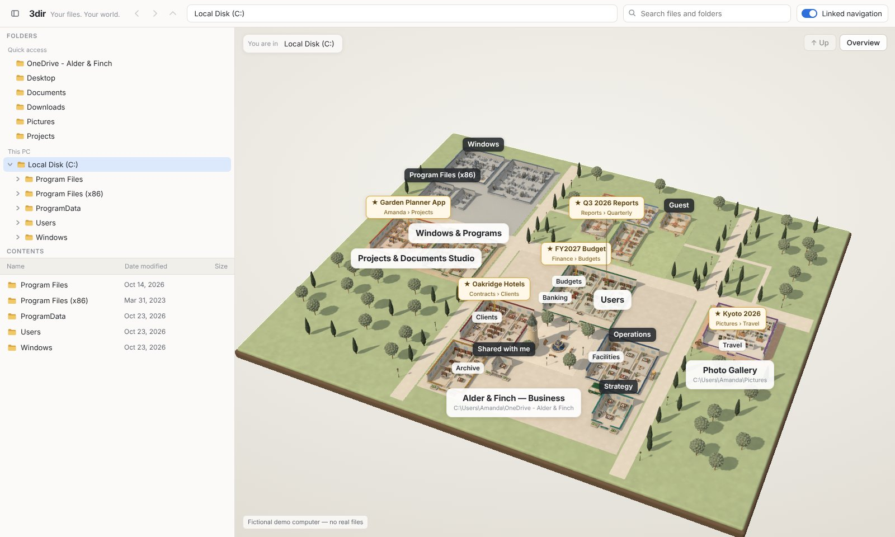 |  |
| | Invented groupings ("Windows & Programs", "Projects & Documents Studio"); promoted districts detached from their parents | Only real folders; AmandaMedicalMiami campus nested in Business › Documents › Amanda › Users |
| Inside | 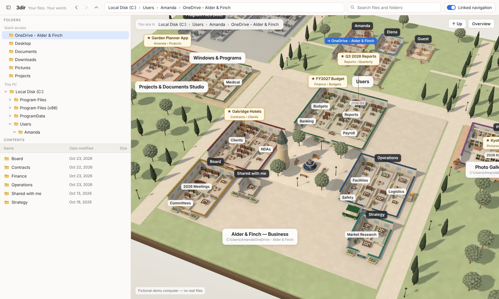 |  |
| Deep folder | dead end (closed box) | 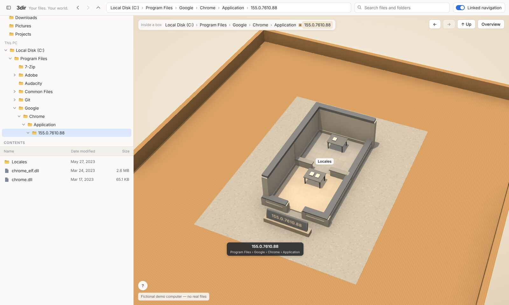 |

Also: `amm-finance`, `amm-clients`, `amm-box` (…\Clients\Biscayne Senior Living\Orders\2026\Q3), `amanda`,
`documents`.

Milestone C (`docs/progress/2026-10-24-milestone-c/`):

| Selection, docked details | Alt held: reveal | Inside a box | Unlinked |
| --- | --- | --- | --- |
| 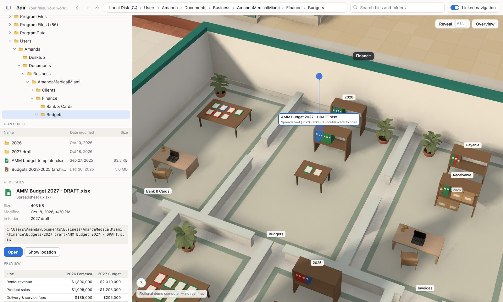 | 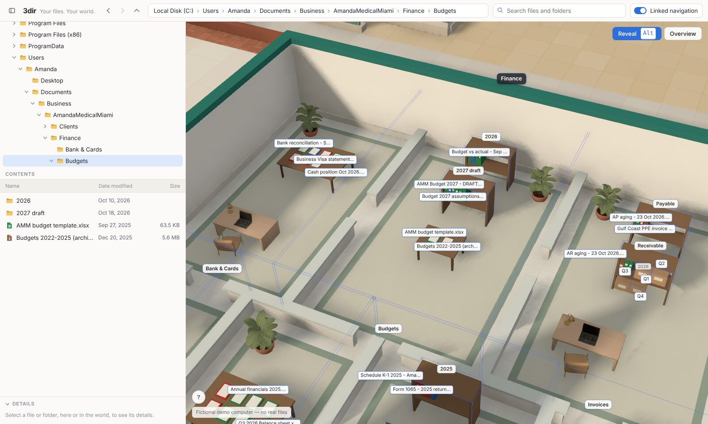 | 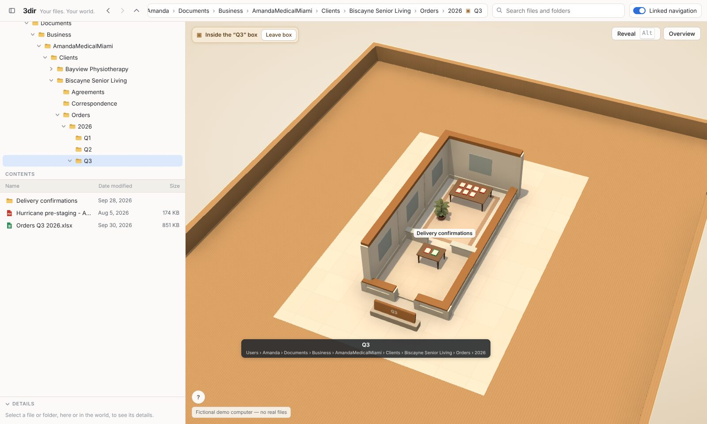 | 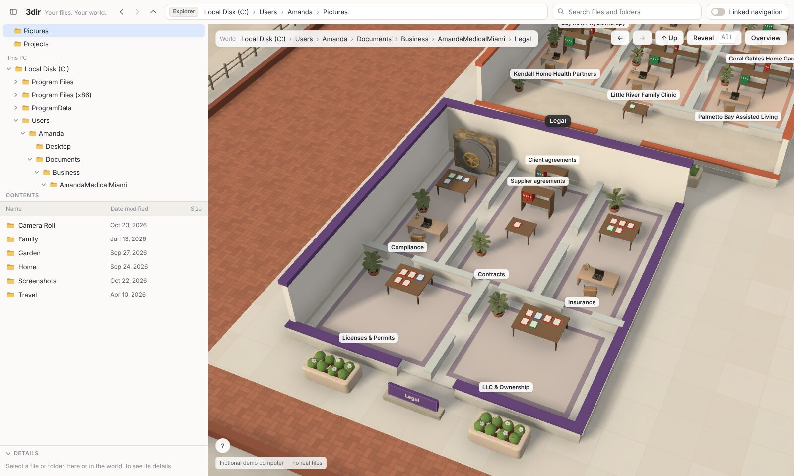 |

Also `hover-box.jpg` (hovering a closed box) and `first-visit.jpg` (one-line guide).

Milestone D (`docs/progress/2026-10-24-milestone-d/`):

| Binders with type labels | Pages on a desk | Folder boxes | Finance, unobstructed |
| --- | --- | --- | --- |
| 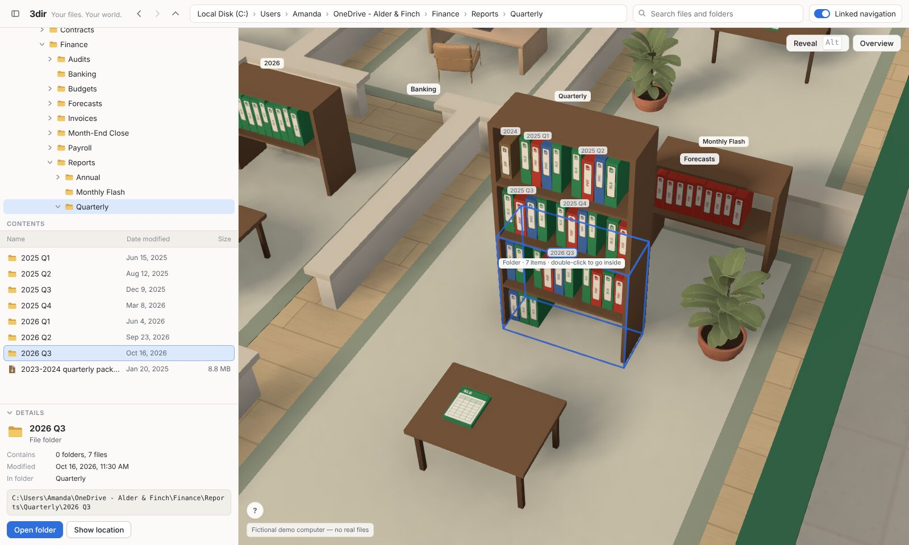 | 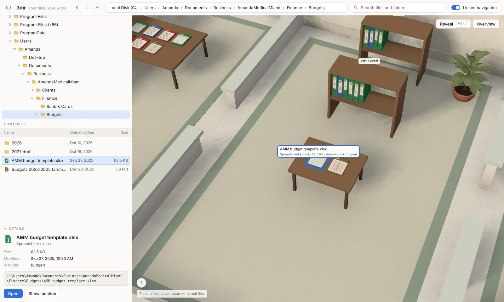 | 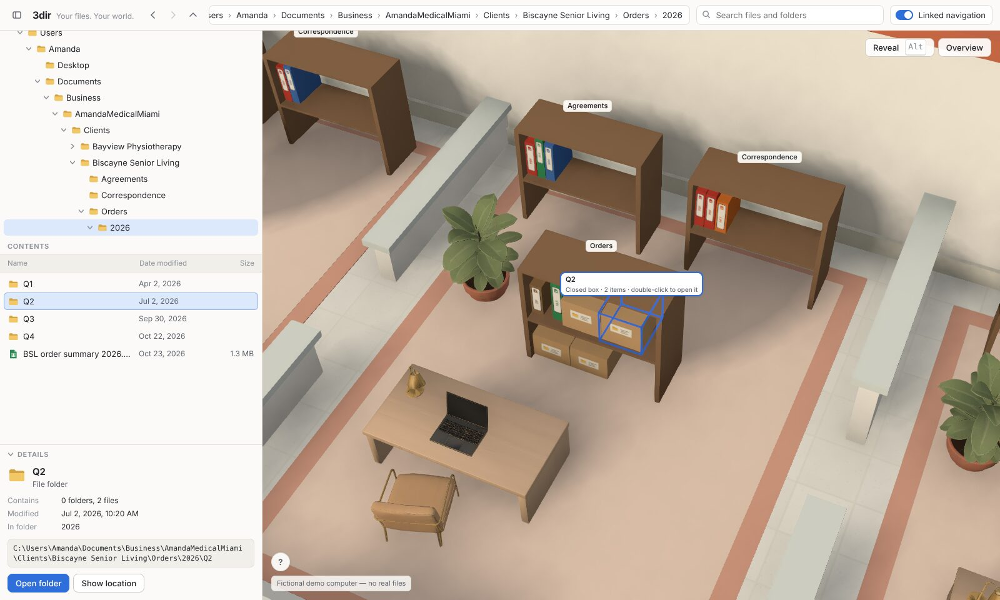 | 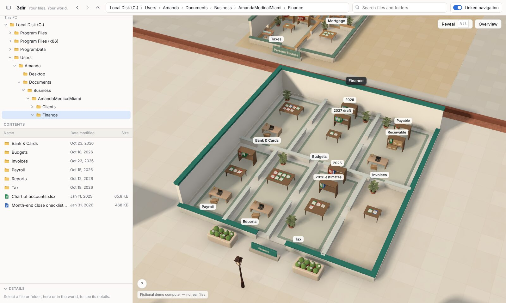 |

Also `overview.jpg` (quieter labels), `amm-campus.jpg`, `amm-box.jpg` and `legend.jpg` (the "?" key).

### Broken / unfinished / known limitations
- Reveal mode names files only where their names fit; dense shelves show a few at a time (outlines show all).
- On browsers where Alt opens a menu bar, use the Reveal button.
- Type codes are per kind (a .csv shows XLS); file faces are drawn textures, not new models.
- Box-worlds still show some empty cardboard around small folders.
- Representation variety (finding G) comes from themes, region metaphors, signature colors and file faces;
  further variety (distinct archetypes for Downloads, Desktop or home interiors) would want new 3D assets,
  which are on hold.
- Region signs give way to more important labels when they collide (by design), so some regions are named
  only by their sign on the ground and in the campus label's path.
- Performance verified only in headless software rendering (slow but correct).

### Next
1. Owner review of iteration 2 on a real GPU (navigation, box-worlds, picking, the new layout, file faces).
2. Candidates, pending that review: more representation variety (would justify specific new assets, which
   need approval), wayfinding signs at region gates, and a first-person or guided-tour camera (postponed).

## Experiment: Spatial Layout Negotiator α.v2 (standalone, 2026-10-25)

`experiments/spatial-layout-negotiator/` implements the five specialized designers (Bookshelf, Room, Building,
Campus, Area) with the measure/arrange protocol and the 20% growth rule, independently of the app. 48 tests,
10 validated SVG drawings (`gallery/index.html`) and measured benchmarks (`results/benchmarks.md`): 5,000
containers measure in about 0.4 s and arrange in under 0.1 s at the default 100 Area attempts. Findings and
limitations are in its README. Not integrated into the app; no credits used.

**Sensitivity study (2026-10-25, branch `claude/negotiator-sensitivity`).** Absorption 20% / 10% / 5% ×
uniform / balanced child-offer sampling (weight = short side / long side), 3 datasets × 5 seeds × 3
allocations: 360 layouts, 0 violations. Balanced sampling gives consistently better proportions for 2–5% more
minimum area. Lower absorption makes rooms and shelves grow much faster than the root (rooms 7× / 13× / 18×
when the root grows 4×) and lowers shelf fill and furniture density; 20% is best of the tested rates, and an
exploratory 35% arm suggests the optimum lies between 20% and 35%. Recommendation: balanced sampling; keep
20%; test 25–30% or per-designer rates before integration. Runtime unchanged. Details: the experiment's README
and `results/sensitivity.md`. 54 tests. App untouched; no credits used.

## Earlier checkpoints
- **Iteration 1 (flagship, accepted):** synthetic computer, 2D explorer, spatial world with the Alder & Finch
  business district, studio, gallery with 40 photos, pins, off-screen indicator, Pages deployment. Screenshots:
  `docs/progress/2026-10-24-flagship/`.

## Repeatable test steps

```
npm install
npm run typecheck
npm test                    # unit tests
npm run build
npm run test:e2e            # smoke test (BASE_PATH=/3dir/ to test the Pages build)
npm run test:interactions   # navigation, picking and explorer/world synchronization
npm run shots -- <outDir> [overview amanda documents amm-campus amm-finance amm-clients amm-box chrome-box
                           first-visit c-selected c-reveal c-hover-box c-in-box c-unlinked
                           d-shelf d-desk d-boxes d-legend business finance budgets budget-file ...]
```

## Budget

| Item | Cost | Approved |
| --- | --- | --- |
| Meshy Premium, first month | $20 | Yes (purchased by owner) |
| Meshy credits, pipeline test | 30 | Yes |
| Meshy credits, stage 2 (cap 900) | **477 used** (19 concepts 57, 19 props 300, 40 photos 120); 423 left | Yes |

Iteration 2 used no credits (generation on hold as instructed). No other spending.
